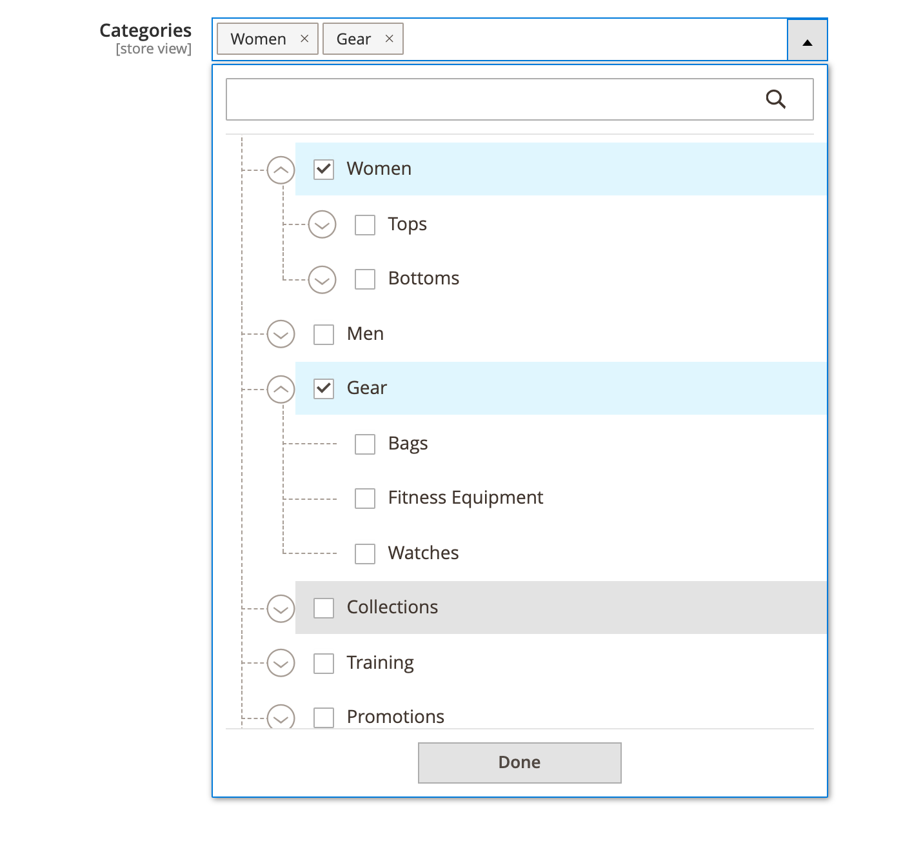

# Magento 2 Stores Configuration Elements Fields

A Magento 2 module that provides enhanced UI elements for the Stores > Configuration section, including a user-friendly cron expression editor field.

The tag list, the cron editor and the code editor are drawn with the shared admin UI kit
([hryvinskyi/magento2-admin-ui](https://github.com/hryvinskyi/magento2-admin-ui)): its typeface, inputs, error text and
colour tokens. The module restyles only the markup it prints itself. The configuration page, its fieldsets, the
"Use system value" checkbox and Magento's buttons keep the admin theme. The category selector is Magento's own select
component: it keeps the admin theme too, and its root reads the kit's colour tokens for its read-only state.

## Features
- **Cron Expression Editor**: Interactive, validated, and human-readable cron field for system configuration.
- **Catalog Category Selector**: A custom field type for selecting categories in the system configuration.
- **Tag List Input**: Tag-style input for managing lists of values (postcodes, SKUs, keywords, etc.).
- **CodeMirror Editor**: Syntax-highlighted code editor supporting multiple languages (CSS, JavaScript, HTML, PHP, SQL, YAML, etc.).
- Modern UI/UX with real-time validation and summary.

## Requirements
- PHP 8.1 or higher
- Magento 2.4.x (Open Source or Adobe Commerce)
- [hryvinskyi/magento2-admin-ui](https://github.com/hryvinskyi/magento2-admin-ui) 1.0 or higher, installed by Composer
  with this module; `Hryvinskyi_AdminUi` must be enabled

## Installation
### Via Composer

```bash
composer require hryvinskyi/magento2-configuration-fields
bin/magento module:enable Hryvinskyi_AdminUi Hryvinskyi_ConfigurationFields
bin/magento setup:upgrade
```

### Manual Installation
1. Copy the module to `app/code/Hryvinskyi/ConfigurationFields`, and the admin UI kit to `app/code/Hryvinskyi/AdminUi`.
2. Run the following Magento CLI commands:
   ```bash
   bin/magento module:enable Hryvinskyi_AdminUi Hryvinskyi_ConfigurationFields
   bin/magento setup:upgrade
   bin/magento setup:di:compile
   bin/magento cache:flush
   ```
   
## How It Works
- The module adds system configuration field types: a cron editor, a tag list, code editors and a category selector.
- The category selector draws a `select` or `multiselect` field as Magento's searchable category tree. A `select`
  field stores one category id, a `multiselect` field the ids joined by commas (`3,7,12`), and the form posts them in
  that form. The categories are labelled in the store view the configuration page edits: the store view itself at
  store-view scope, the website's default store view at website scope, the admin names at default scope. They are
  read from the catalog once per store view and admin role and kept in Magento's cache under the module's own id
  (`HRYVINSKYI_CONFIGURATION_FIELDS_CATEGORY_OPTIONS_<store>[_<role>]`), tagged with the category cache tag and the
  block cache tag, so cleaning either reads them again. A field of any other type is shown as a notice naming the
  type, and posts nothing.
- The cron editor provides validation, error highlighting, and a summary of the cron schedule. The value is stored as a
  standard cron expression string; an empty field stays empty until someone edits it. A field that holds an expression
  cannot be cleared: the form refuses to save it empty, because a job that reads its schedule from the field would
  stop running. The field's own `<validate>` classes (such as `required-entry`) apply to the expression it posts, and
  their messages show under the field; the cron rule's own message is the summary above the parts.
- The summary of the cron editor is written in the language of the admin user's interface (the locale Magento's
  locale resolver reports in the admin area, such as `de_DE`). The editor chooses the bundle's locale for it: the
  language and region as the bundle spells them, then the language alone (`de_AT` is described in `de`), then English
  for a language the bundle lacks. Only the summary is translated; the part labels and the syntax table use the
  module's own dictionary.
- The cron editor accepts what Magento's cron scheduler runs: in every part `*`, a number, a range `a-b`, a step on
  `*`, a number or a range (`*/15`, `1-30/5`), and comma lists of these; months and weekdays by name (`jan`,
  `Mon-Fri`, `january`: Magento reads the first three letters). A number that never matches a time (a minute of 61)
  is saved, as Magento accepts it, and the summary says in a neutral tone that the schedule cannot be described in
  words. Numbers are written in digits, at most two besides leading zeros (`99`, `007`): no part counts past 59, and
  a number too large for an integer makes Magento's scheduler fail converting it every time it runs. A step of zero
  (`*/0`) is refused: Magento's scheduler fails on it every time it runs. Parts are separated by
  the whitespace Magento's scheduler splits on (spaces, tabs, line breaks); a no-break space belongs to a part and
  makes it invalid. The editor edits five parts. Magento also accepts a sixth part, which it never reads: a stored
  six-part expression is accepted as it is, its five parts are shown, and an edit keeps the sixth part after them.
- The cron editor checks the expression in the browser only. A field that names the module's cron backend model
  (below) is checked again on every save, the command line included, with the same rule.
- A stored tag-list value the field cannot read as a list in its save type's format (values joined by a newline in a
  `json` field, as a `config.xml` default or `config:set` may write them, a corrupted value, or a list none of whose
  entries is a value, such as `[true,null]`) is kept as it is: the widget shows a notice and no values, the next save
  of the section stores it re-encoded as values split by the separator, and the field is logged with its path. Adding
  or removing a value replaces it with the list shown. An empty list in the field's format (`[]`, `a:0:{}`) is an
  empty field: no notice, and the next save stores an empty value.
- A stored value that is not valid UTF-8 is shown with its malformed bytes replaced instead of stopping the page. An
  invalid byte is shown and, on the next save of the section, stored as the replacement character, which is PHP's
  mbstring substitute character (`?` unless `mb_substitute_character()` says otherwise). The tag list's backend model
  refuses to save a posted value that is not valid UTF-8.
- A field whose value is inherited from a wider scope ("Use system value" checked), or locked in `app/etc/config.php`
  or `env.php`, is shown read-only, as Magento shows its own fields.
- Every value printed into the page is escaped, and each widget's settings reach its script as JSON in which `<` and
  `>` are escaped, so a stored value such as `</script>` is shown as text.

### The look and the markup hooks

Each widget's own root element carries a kit root class, a module class and, where an earlier version printed one,
that version's root class, which stays for themes and scripts that hook it. The kit root class is `hui`, except around
Magento's own markup: the category selector's root carries `hui-tokens`, the kit's tokens without its base rules, so
Magento's select component keeps the admin theme's controls:

| Widget | Root classes | Root `data-role` |
|--------|--------------|------------------|
| Tag list | `hui hcf-tag-list tag-list-root` | `hcf-tag-list` |
| Cron editor | `hui hcf-cron cron-editor-root` | `hcf-cron` |
| Code editor | `hui hcf-code codemirror-editor-root` (`hui-tokens hcf-code` in a UI form) | `hcf-code` |
| Category selector | `hui-tokens hcf-ui-select` (`hui hcf-ui-select` around the notice for a type it cannot draw) | `hcf-ui-select` |

The root carries `data-disabled="true"` while the field is read-only. The parts inside are found by `data-role`:
`hcf-tag-list-chips`, `hcf-tag-list-input`, `hcf-tag-list-search`, `hcf-tag-list-value`, `hcf-tag-list-error`,
`hcf-tag-list-unread` (the notice about a stored value that cannot be read), `hcf-tag-list-chip` and
`hcf-tag-list-remove` for the tag list; `hcf-cron-summary`, `hcf-cron-field` (with
`data-part` = `minute`, `hour`, `dayOfMonth`, `month` or `dayOfWeek`), `hcf-cron-syntax` and `hcf-cron-value` for the
cron editor; `hcf-ui-select-control` (where Magento's select component renders), `hcf-ui-select-value` and
`hcf-ui-select-unsupported` for the category selector. An invalid entry is marked with `aria-invalid="true"`.

A subclass of a field block that declares its own constructor must pass `$data` on to the parent constructor: the
block's view model arrives as an item of that argument.

## Example system.xml Usage

```XML
<field id="expression" translate="label" type="text" sortOrder="10" showInDefault="1" showInWebsite="1" showInStore="1">
    <label>Cron Expression</label>
    <frontend_model>Hryvinskyi\ConfigurationFields\Block\Adminhtml\System\Config\Form\Field\CronEditor</frontend_model>
</field>

<!-- The same field, with the expression checked again when the section is saved -->
<field id="expression_checked" translate="label" type="text" sortOrder="15" showInDefault="1" showInWebsite="1" showInStore="1">
    <label>Cron Expression</label>
    <frontend_model>Hryvinskyi\ConfigurationFields\Block\Adminhtml\System\Config\Form\Field\CronEditor</frontend_model>
    <backend_model>Hryvinskyi\ConfigurationFields\Model\Config\Backend\CronExpression</backend_model>
</field>

<field id="category" translate="label" type="multiselect" sortOrder="20" showInDefault="1" showInWebsite="1" showInStore="1">
   <label>Categories Multiselect</label>
   <frontend_model>Hryvinskyi\ConfigurationFields\Block\Adminhtml\System\Config\Form\Field\UiSelect</frontend_model>
</field>

<field id="category" translate="label" type="select" sortOrder="20" showInDefault="1" showInWebsite="1" showInStore="1">
   <label>Categories Select</label>
   <frontend_model>Hryvinskyi\ConfigurationFields\Block\Adminhtml\System\Config\Form\Field\UiSelect</frontend_model>
</field>

<!-- Tag List Input - for managing lists of values like postcodes, SKUs, keywords -->
<field id="tag_list" translate="label comment" type="text" sortOrder="30" showInDefault="1" showInWebsite="1" showInStore="0">
    <label>Tag list</label>
    <comment>Type a value and press Enter to add. Use % as wildcard.</comment>
    <frontend_model>Hryvinskyi\ConfigurationFields\Block\Adminhtml\System\Config\Form\Field\TagList</frontend_model>
</field>

<!-- CodeMirror Editors - syntax-highlighted code editors -->
<field id="custom_css" translate="label" type="textarea" sortOrder="40" showInDefault="1" showInWebsite="1" showInStore="1">
    <label>Custom CSS</label>
    <frontend_model>Hryvinskyi\ConfigurationFields\Block\Adminhtml\System\Config\Form\Field\CodeMirror\CssEditor</frontend_model>
</field>

<field id="custom_js" translate="label" type="textarea" sortOrder="50" showInDefault="1" showInWebsite="1" showInStore="1">
    <label>Custom JavaScript</label>
    <frontend_model>Hryvinskyi\ConfigurationFields\Block\Adminhtml\System\Config\Form\Field\CodeMirror\JavascriptEditor</frontend_model>
</field>
```

### Checking a cron expression on save

A cron field opts in to the server's check by naming the backend model
`Hryvinskyi\ConfigurationFields\Model\Config\Backend\CronExpression` (the example above). It applies the editor's
rule on every save, from the admin and from `bin/magento config:set` alike, and refuses an expression Magento's
scheduler cannot run with a message naming the field and the value; the refusal stops the save of the whole section.
An empty value is saved, and a valid one is stored as posted. A field without the backend model is checked in the
browser only. The module does not depend on `Magento_Cron`: the rule is its own, and every expression it accepts is
one Magento's scheduler runs.

### Tag List Configuration via DI

For custom TagList configuration, create virtual types in your module's `di.xml`:

**Step 1: Create virtual types in di.xml**

```xml
<!-- Frontend model with custom configuration -->
<virtualType name="MyModule\Block\Adminhtml\MyTagList"
             type="Hryvinskyi\ConfigurationFields\Block\Adminhtml\System\Config\Form\Field\TagList">
    <arguments>
        <argument name="tagListConfig" xsi:type="array">
            <item name="placeholder" xsi:type="string">Enter value and press Enter...</item>
            <item name="validation" xsi:type="string">^[A-Za-z0-9%]+$</item>
            <item name="uppercase" xsi:type="boolean">true</item>
            <item name="separator" xsi:type="string">\n</item>
        </argument>
    </arguments>
</virtualType>

<!-- Backend model with matching configuration -->
<virtualType name="MyModule\Model\Config\Backend\MyTagList"
             type="Hryvinskyi\ConfigurationFields\Model\Config\Backend\TagList">
    <arguments>
        <argument name="tagListConfig" xsi:type="array">
            <item name="separator" xsi:type="string">\n</item>
        </argument>
    </arguments>
</virtualType>
```

**Step 2: Reference in system.xml**

```xml
<field id="my_tags" translate="label" type="text" sortOrder="10" showInDefault="1">
    <label>My Tags</label>
    <frontend_model>MyModule\Block\Adminhtml\MyTagList</frontend_model>
    <backend_model>MyModule\Model\Config\Backend\MyTagList</backend_model>
</field>
```

### Configuration Options

| Option | Type | Default | Description |
|--------|------|---------|-------------|
| `placeholder` | string | "Type value and press Enter..." | Input placeholder text |
| `validation` | string | ``^[a-zA-Z0-9.!#$%&'*+\/=?^_`"{\|}~-]+$`` | Regex pattern for validation (letters, digits and ``. ! # $ % & ' * + / = ? ^ _ ` " { \| } ~ -``, no spaces) |
| `validation_message` | string | With the default `validation`: "Use letters, digits and ``. ! # $ % & ' * + / = ? ^ _ ` " { \| } ~ -`` only, without spaces."; with a pattern of the field's own: "This value does not match the format this field accepts." | Message shown for a value that does not match |
| `uppercase` | boolean | true | Auto-uppercase input values |
| `separator` | string | `\n` | Separator for values (`\n`, `\t`, `,`, etc.) |
| `save_type` | string | separator | Storage format: `json`, `serialized`, or `separator` |

### Values checked on save

The backend model checks every value against the field's `validation` pattern before it stores the list, from the
admin and from `bin/magento config:set` alike, and decides as the browser does:

- **The settings are the frontend model's declared argument.** The save finds the field by its configuration path in
  the admin's configuration structure and reads the `tagListConfig` argument declared for its `frontend_model` when
  that is the tag-list block (or a subclass or virtual type of it): `validation`, `uppercase` and
  `validation_message` are declared once, on the block, and a backend virtual type shared by several fields checks
  each field by its own pattern. The backend model's own `tagListConfig` gives the separator and the save type, and
  the pattern only for a field whose frontend model is not a tag list (or that has none). Only the declared argument
  counts: no block is built for the check, so a block subclass that changes its settings in code (in its
  constructor) changes what the browser shows but not what the save checks.
- **The same check in every area.** Declare the field block's virtual type in your module's `etc/adminhtml/di.xml`,
  as the field is shown only in the admin; the backend model's virtual type goes in `etc/di.xml`, as configuration is
  saved from every area. Wherever the value is saved (the admin, the storefront, cron, the web API, a setup patch,
  `bin/magento config:set`), the argument is read from the global and admin-area `di.xml` declarations, merged as
  the container merges them, and never applied to the running container, so a storefront or cron request keeps its
  own area's configuration. The declarations are read at the first tag-list save of a process and kept for the rest
  of it (from Magento's config cache once it holds them).
- **The pattern is the browser's.** It is the source of a JavaScript regular expression, compiled without flags; the
  server translates it to PCRE: `/` is escaped, `\uXXXX` becomes `\x{XXXX}`, `$` matches only at the end of the value,
  `.` matches any character but a line break or the line and paragraph separators, `\s` matches JavaScript's white
  space and line terminators (a no-break space, U+2028, U+FEFF and the other Unicode spaces among them) and `\S`
  everything else, inside a character class too (`[^\s,]`), a `-` beside `\d`, `\D`, `\w`, `\W`, `\s` or `\S` in a
  class is a hyphen (`[\d-z]`, `[\w-.]`), `\d`, `\w` and `\b` stay ASCII, and the pattern and values are read as
  UTF-8.
- **Upper-casing serves the match only.** With `uppercase` set, a value is upper-cased before it is matched (`sw1a 1aa`
  matches `^[A-Z0-9 ]+$`), and stored as posted.
- **A refusal stops the section.** A value the pattern refuses refuses the save of its whole section, with a message
  naming the field, the value and the field's `validation_message`. A pattern PCRE cannot compile refuses every save
  of its field with a message naming it, where the browser accepts any value.

A value stored before this check existed that does not match its field's pattern now blocks the save of its section
until it is fixed or removed.

### Storage Formats

| Save Type | Description | Storage Example |
|-----------|-------------|-----------------|
| `separator` | Values separated by a character (default) | `VALUE1\nVALUE2\nVALUE3` |
| `json` | JSON array format | `["VALUE1","VALUE2","VALUE3"]` |
| `serialized` | PHP serialized format | `a:3:{i:0;s:6:"VALUE1";...}` |

A `save_type` no format is registered under refuses the save with a message that names it. The field still renders:
it reads the stored value as values joined by the separator and logs the unknown save type with the field's path.
Another module adds a storage format by implementing `Hryvinskyi\ConfigurationFields\Api\TagListCodecInterface` and
adding it to the `codecs` argument of `Hryvinskyi\ConfigurationFields\Model\TagList\CodecPool` in its `di.xml`. Its
`decode()` returns the values, an empty list for an empty value or an empty list in its format, and `null` for a
stored value it cannot read, which the field then keeps as it is.

### Complete Example

**di.xml:**
```xml
<!-- Excluded TagList -->
<virtualType name="MyModule\Block\Adminhtml\TagList"
             type="Hryvinskyi\ConfigurationFields\Block\Adminhtml\System\Config\Form\Field\TagList">
    <arguments>
        <argument name="tagListConfig" xsi:type="array">
            <item name="placeholder" xsi:type="string">Enter pattern...</item>
            <item name="validation" xsi:type="string">^[A-Za-z0-9%]+$</item>
            <item name="uppercase" xsi:type="boolean">true</item>
            <item name="separator" xsi:type="string">\n</item>
            <item name="save_type" xsi:type="string">separator</item>
        </argument>
    </arguments>
</virtualType>

<virtualType name="MyModule\Model\Config\Backend\TagList"
             type="Hryvinskyi\ConfigurationFields\Model\Config\Backend\TagList">
    <arguments>
        <argument name="tagListConfig" xsi:type="array">
            <item name="separator" xsi:type="string">\n</item>
            <item name="save_type" xsi:type="string">separator</item>
        </argument>
    </arguments>
</virtualType>
```

**system.xml:**
```xml
<field id="tag_list" translate="label comment" type="text" sortOrder="30" showInDefault="1">
    <label>Tag List</label>
    <comment>Tag list comment</comment>
    <frontend_model>MyModule\Block\Adminhtml\TagList</frontend_model>
    <backend_model>MyModule\Model\Config\Backend\TagList</backend_model>
</field>
```

### CodeMirror Editor Classes

The module provides pre-built CodeMirror editor classes for common languages in the `CodeMirror` namespace. Use them directly in your `system.xml`:

**Namespace:** `Hryvinskyi\ConfigurationFields\Block\Adminhtml\System\Config\Form\Field\CodeMirror\`

**Available Editor Classes:**

| Class | Language | Mode |
|-------|----------|------|
| `CssEditor` | CSS | `css` |
| `LessEditor` | LESS | `text/x-less` |
| `ScssEditor` | SCSS | `text/x-scss` |
| `JavascriptEditor` | JavaScript | `javascript` |
| `JsonEditor` | JSON | `application/json` |
| `HtmlEditor` | HTML (mixed) | `htmlmixed` |
| `XmlEditor` | XML | `xml` |
| `PhpEditor` | PHP | `php` |
| `SqlEditor` | SQL | `sql` |
| `YamlEditor` | YAML | `yaml` |
| `MarkdownEditor` | Markdown | `markdown` |
| `ShellEditor` | Shell/Bash | `shell` |

**Usage in system.xml:**

```xml
<!-- CSS Editor -->
<field id="custom_css" translate="label" type="textarea" sortOrder="10" showInDefault="1">
    <label>Custom CSS</label>
    <frontend_model>Hryvinskyi\ConfigurationFields\Block\Adminhtml\System\Config\Form\Field\CodeMirror\CssEditor</frontend_model>
</field>

<!-- JavaScript Editor -->
<field id="custom_js" translate="label" type="textarea" sortOrder="20" showInDefault="1">
    <label>Custom JavaScript</label>
    <frontend_model>Hryvinskyi\ConfigurationFields\Block\Adminhtml\System\Config\Form\Field\CodeMirror\JavascriptEditor</frontend_model>
</field>

<!-- JSON Editor -->
<field id="json_config" translate="label" type="textarea" sortOrder="30" showInDefault="1">
    <label>JSON Configuration</label>
    <frontend_model>Hryvinskyi\ConfigurationFields\Block\Adminhtml\System\Config\Form\Field\CodeMirror\JsonEditor</frontend_model>
</field>

<!-- HTML Editor -->
<field id="custom_html" translate="label" type="textarea" sortOrder="40" showInDefault="1">
    <label>Custom HTML</label>
    <frontend_model>Hryvinskyi\ConfigurationFields\Block\Adminhtml\System\Config\Form\Field\CodeMirror\HtmlEditor</frontend_model>
</field>
```

### Custom CodeMirror Configuration via DI

For custom configuration (theme, options), create virtual types in your module's `di.xml`:

```xml
<!-- Custom CSS Editor with Monokai theme -->
<virtualType name="MyModule\Block\Adminhtml\DarkCssEditor"
             type="Hryvinskyi\ConfigurationFields\Block\Adminhtml\System\Config\Form\Field\CodeMirror\CssEditor">
    <arguments>
        <argument name="editorConfig" xsi:type="array">
            <item name="theme" xsi:type="string">monokai</item>
            <item name="line_numbers" xsi:type="boolean">true</item>
            <item name="line_wrapping" xsi:type="boolean">false</item>
        </argument>
    </arguments>
</virtualType>
```

**Configuration Options:**

| Option           | Type    | Default     | Description                |
|------------------|---------|-------------|----------------------------|
| `mode`           | string  | (per class) | Syntax highlighting mode   |
| `theme`          | string  | `default`   | Editor color theme         |
| `line_numbers`   | boolean | `true`      | Show line numbers          |
| `line_wrapping`  | boolean | `true`      | Wrap long lines            |

**Available Themes:**
- `default` - Light theme (default)
- `monokai` - Dark theme with vibrant colors
- `material` - Material Design inspired
- `dracula` - Dark purple theme

### CodeMirror UI Component Usage

For UI component forms (admin forms, not system configuration), use the CodeMirror form element.

The element draws the code editor's own markup: a root `<div class="hui-tokens hcf-code" data-role="hcf-code">` that
carries `data-disabled="true"` while the element is disabled. The root carries the kit's tokens alone (`hui-tokens`),
not its base rules, because the form around it is Magento's markup. The editor's colours come from
`css/codemirror-editor.css`, which no page links by itself: the page that holds the form asks for the layout handle
`hryvinskyi_configuration_fields_code_editor` in its own layout file. The handle links the admin UI kit's stylesheet,
then the editor's, so the editor reads the kit's tokens and overrides a kit rule of the same weight by order:

```xml
<page xmlns:xsi="http://www.w3.org/2001/XMLSchema-instance"
      xsi:noNamespaceSchemaLocation="urn:magento:framework:View/Layout/etc/page_configuration.xsd">
    <update handle="hryvinskyi_configuration_fields_code_editor"/>
    …
</page>
```

A form rendered into a modal gets no head of its own, so the page that hosts the modal asks for the handle. A page that
does not ask still gets a working editor, with CodeMirror's own default colours and no kit tokens.

**In your UI component XML:**

```xml
<field name="custom_code" formElement="textarea">
    <argument name="data" xsi:type="array">
        <item name="config" xsi:type="array">
            <item name="component" xsi:type="string">Hryvinskyi_ConfigurationFields/js/form/element/codemirror</item>
            <item name="template" xsi:type="string">ui/form/field</item>
            <item name="editorConfig" xsi:type="array">
                <item name="mode" xsi:type="string">css</item>
                <item name="theme" xsi:type="string">default</item>
                <item name="lineNumbers" xsi:type="boolean">true</item>
                <item name="lineWrapping" xsi:type="boolean">true</item>
            </item>
        </item>
    </argument>
    <settings>
        <label translate="true">Custom Code</label>
        <dataType>text</dataType>
    </settings>
</field>
```

## Development checks

Run from the Magento root; the module ships its own configuration for each tool.

- Unit tests: `vendor/bin/phpunit -c app/code/Hryvinskyi/ConfigurationFields/phpunit.xml.dist`
- Static analysis (PHPStan 2, level 10): `phpstan analyse -c app/code/Hryvinskyi/ConfigurationFields/phpstan.neon.dist --level=10`
- Coding standard: from the module directory, `vendor/bin/phpcs --standard=phpcs.xml.dist` (the ruleset is Magento2 and
  leaves out the vendored CodeMirror sources, `foldgutter.css` and the cronstrue bundle, and checks everything else,
  the module's Node tests included; passing `--standard=Magento2` instead ignores those exclusions)
- Browser code: `node --test 'app/code/Hryvinskyi/ConfigurationFields/Test/Js/**/*.test.cjs'`
- Integration tests: `app/code/Hryvinskyi/ConfigurationFields/Test/Integration` through Magento's integration suite

## Screenshots

Tag lists, one stored as values joined by a line break and one as a JSON array:


The cron editor, with the expression read back in words:


The code editor (CodeMirror), here in CSS mode:


The category selector:



## Third-party software

- **cronstrue 2.61.0**, MIT License, Copyright (c) 2017 Brady Holt (https://github.com/bradymholt/cRonstrue):
  `view/adminhtml/web/js/cronstrue.js` is its build with every locale (`dist/cronstrue-i18n.min.js`) and keeps its
  licence notice in the file header. The only change is that the module definition is anonymous, so RequireJS names it
  after the file. The build is about 170 KB where the English-only build was about 21 KB; the admin loads it only on
  a page with a cron field. Updating it means replacing that file with the same build of a newer release, keeping the
  header and the anonymous definition.

## Support

For issues, questions or contributions, please contact the author or create an issue in the GitHub repository.

## Author

- **Volodymyr Hryvinskyi**
- Email: volodymyr@hryvinskyi.com
- GitHub: https://github.com/hryvinskyi

## License

This project is licensed under the MIT License.
